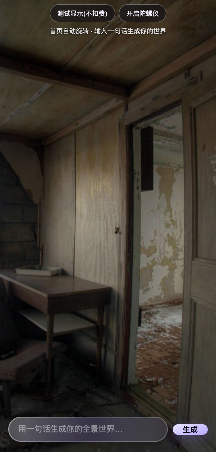

# TurnWorld

面向手机浏览器的 360° 全景原型：输入场景描述，通过 Skybox AI 生成全景，再用拖动或设备方向浏览。



## 当前范围

- Three.js 全景显示、拖动视角、可选陀螺仪控制。
- Node.js 服务端转发生成请求，API Key 不发送给浏览器。
- 无账户、配额管理或持久化世界列表；当前定位为个人原型。

## 本地运行

需要 Node.js 22 或更高版本。服务端使用 Node 内置模块，无需安装 npm 依赖。

```bash
cp .env.example .env
npm start
```

打开 <http://127.0.0.1:8787>。不配置密钥也可以打开页面并点击“测试显示(不扣费)”。前端依赖和示例全景从外部站点加载，需要网络连接。

生成自己的场景时，在 `.env` 中设置 `BLOCKADE_API_KEY`，重启服务。生成会消耗所配置服务的额度。

手机陀螺仪需要 HTTPS 和用户授权；无法授权时仍可拖动浏览。普通局域网 HTTP 地址不满足设备方向权限要求。

## 部署边界

默认仅监听 `127.0.0.1`。容器或反向代理环境需要显式设置 `HOST=0.0.0.0`，并在访问入口配置身份验证和 HTTPS 后再开放生成接口。本项目尚未实现公开服务所需的用户鉴权与额度控制，不应把带付费密钥的接口直接匿名开放。

静态文件只从 `public/` 提供，不要把项目根目录设为静态目录。不要提交 `.env`。

## 检查

```bash
npm test
```

检查首页、脚本、样式和健康检查可访问，同时确认服务代码及配置不会作为静态资源提供。测试不调用付费生成接口。

## 目录

```text
public/          页面、全景交互与样式
server.mjs       静态服务与 Skybox API 代理
.env.example     本地配置示例
instructions.md  最初的原型需求
```

## 请求处理结构

- `server.mjs`：路由与静态资源入口。
- `server/http.mjs`：有大小限制的 JSON 读取和统一错误响应。
- `server/upstream.mjs`：Skybox 请求、30 秒超时及上游错误分类。
- `server/image-proxy.mjs`：图片来源、重定向、类型与流式大小校验。

图片代理接受 `images.blockadelabs.com` 及其子域、`blockade-platform-production.s3.amazonaws.com`，仅允许 HTTPS 的 JPEG、PNG、WebP。若供应商使用新的 CDN，确认实际域名后再更新白名单；不要放开整个云存储域名。每次重定向都重新校验来源，超过 140 MiB 的响应会中止读取。请求 JSON 上限为 64 KiB，prompt 上限为 2,000 字符。

错误响应区分输入错误（400/413）、上游不可用或返回无效内容（502）、上游超时（504）。`npm test` 使用本地 HTTP 服务和模拟上游覆盖这些分支，不调用收费生成接口。
